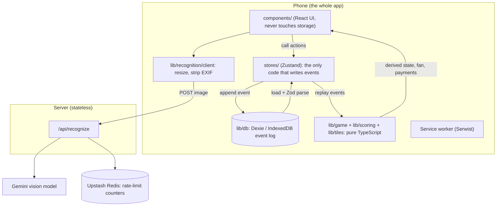
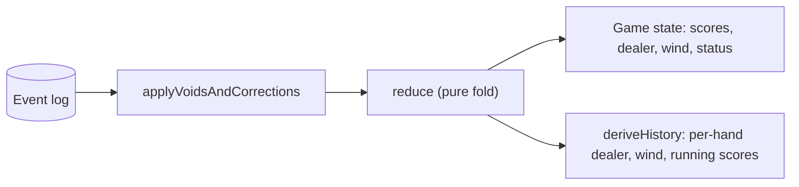
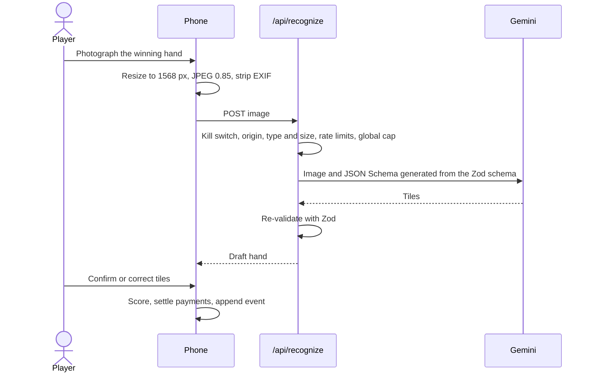

# Architecture

Mahjong Scorer is a Next.js PWA in which the phone owns all game logic and state. The only server code is one stateless route that turns a hand photo into tile codes.

## System overview

Three properties define the design:

- **One source of truth.** The Dexie event log is the only place game facts are stored. Scores, dealer, winds and history are all computed from it.
- **One direction of dependency.** The pure domain core knows nothing about React, storage or the network. Everything else depends on it, never the reverse.
- **One fallible, paid dependency, kept at arm's length.** The vision model is advisory. Its output is validated, a person confirms it, and the app is fully usable without it.

## Layers and boundaries

| Layer                  | Path                                   | Responsibility                                                | May import                      |
| ---------------------- | -------------------------------------- | ------------------------------------------------------------- | ------------------------------- |
| UI                     | `app/`, `components/`                  | Render derived state, call store actions                      | stores, `lib/*`                 |
| Store                  | `stores/`                              | The only writer of events; derives state after each append    | `lib/*`                         |
| Persistence            | `lib/db/`                              | Dexie schema, `appendEvent`, `loadEvents`, backup and restore | `lib/game` types                |
| Domain core            | `lib/tiles`, `lib/scoring`, `lib/game` | Tiles, fan rules, payments, events, reducer, dice, seats      | nothing outside pure TypeScript |
| Recognition            | `lib/recognition/`                     | Client resize, server pipeline, schema, validation            | domain core types               |
| Security and analytics | `lib/security/`, `lib/analytics/`      | Headers, opt-in analytics, error scrubbing                    |                                 |

ESLint enforces the domain-core boundary with `no-restricted-imports`: `lib/tiles`, `lib/scoring` and `lib/game` fail the lint step if they import React, Next.js, Dexie, Zustand, the network, or the UI, store and storage layers. `react/no-danger` is an error everywhere.

## State: an append-only event log

A game is a list of versioned events. Events are appended and never edited or deleted; undo and edit are themselves events that point at the original.

| Event                                              | Meaning                                                           |
| -------------------------------------------------- | ----------------------------------------------------------------- |
| `GameCreated`                                      | Players, and a copy of the ruleset the game is played under       |
| `SeatsAssigned`, `FirstDealerChosen`, `DiceRolled` | Setup                                                             |
| `HandWon`, `HandDrawn`                             | A hand finished                                                   |
| `HandVoided`, `HandCorrected`                      | Undo and edit, referencing the original event                     |
| `StateOverridden`                                  | A manual dealer or wind fix when the table disagrees with the app |
| `GameEnded`                                        | The game is over                                                  |

Every event shares an envelope: `id` (UUID), `gameId`, `seq` (per-game order, part of the primary key), `v` (payload schema version), `at` (display only) and a `payload` discriminated union. Order never depends on device clocks.

`replay(events)` is the only thing that computes game state. It removes voided hands, swaps a corrected hand's payload into the original event, and folds the result through a pure reducer. After an undo or edit the answer is always "replay", so there is no inverse bookkeeping to get wrong.

A won hand stores its computed fan, breakdown, payments and the `engineVersion` that produced them, not just its tiles. Fixing a scoring bug therefore cannot silently rewrite finished games.

## The write path

Exactly one place calls `appendEvent`: the game store. Each action follows one pattern:

1. A **plan** (a pure function of current state) returns an event payload or a refusal reason.
2. The store appends the event with the `seq` it expects next.
3. Inside one IndexedDB transaction, `appendEvent` checks the highest `seq`. A mismatch throws `DuplicateSeqError` without writing.
4. On a conflict (for example a second tab), the store reloads, replays, re-runs the plan's guard against fresh state, and retries up to three times.
5. After a durable append it derives new state and emits analytics. The denormalized `games` row is synced last and best-effort.

## Photo to score

The model only supplies tile identities. Exposed versus concealed melds, the winning tile and the self-drawn flag come from the player, never the image. After one retry the app falls back to the manual tile picker, which is also the only path offline.

## Offline and durability

- **Service worker.** Serwist precaches the app shell. `/api/recognize` is network-only. A new worker waits, and an "Update ready" bar reloads only when the player taps it; the bar is hidden on the hand-entry route so an update can never interrupt a hand.
- **Storage.** Browser storage is treated as fragile. The app requests persistent storage, nudges iOS Safari users to install to the Home Screen, offers one-tap JSON backup, and imports backups additively only, validated against the same Zod schemas as stored events.

## Where to read next

- [Decision records](adr/README.md) for the reasoning behind each choice.
- [Scoring rules](scoring-rules.md) for the engine.
- [Security and privacy](security-and-privacy.md) for the recognition route's defences.
