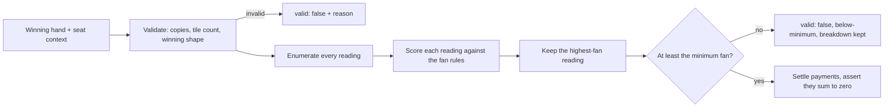

# Scoring rules

How the engine scores a Hong Kong (old style) hand, and how that behaviour is kept correct. The code lives in `lib/scoring/`; the reasoning is in [ADR 0006](adr/0006-scoring-engine-readings-and-rules-as-data.md).

## Pipeline

## Fan rules

Each rule is a data object with an `applies` function and an `excludes` list. Rules are evaluated in a fixed order, excluded rules are removed from the breakdown, and a hand that scores nothing falls back to "chicken hand" at 0 fan.

| Group       | Rules (fan)                                                                                                                                                                                                                                                                               |
| ----------- | ----------------------------------------------------------------------------------------------------------------------------------------------------------------------------------------------------------------------------------------------------------------------------------------- |
| Basic       | Self-drawn (1), concealed hand (1), no flowers (1), own seat flower or season (1), complete set of flowers or seasons (2), dragon pung (1), seat wind pung (1), prevailing wind pung (1), all chows (1), win on the last tile (1), win on a kong replacement tile (1), robbing a kong (1) |
| Patterns    | All pungs (3), mixed one suit (3), seven pairs (4, only when the ruleset allows it), small three dragons (5), all one suit (7), great three dragons (8), four concealed pungs (8)                                                                                                         |
| Limit hands | Small four winds, great four winds, all honours, all terminals, nine gates, thirteen orphans, four kongs, heavenly hand, earthly hand. Each collapses to the ruleset's cap once                                                                                                           |

## Rulesets

A `Ruleset` is versioned data that is copied into the game when it is created, so editing a preset later never changes games already played.

| Preset                        | Minimum fan | Cap | Payment model                               |
| ----------------------------- | ----------- | --- | ------------------------------------------- |
| `hk-discarder-pays` (default) | 3           | 10  | Discarder pays alone                        |
| `hk-all-pay`                  | 3           | 10  | Discarder pays in full, the others pay half |
| `hk-casual`                   | 1           | 8   | Discarder pays alone                        |

Fan maps to base points through a table (1 fan is 2 points, doubling roughly every fan up to 10 fan at 128). Payment models express what each seat pays as a multiple of the base points. All points are integers, and payments are asserted to sum to zero.

## Invalid hands are results

The engine returns `valid: false` with a reason instead of throwing:

| Reason               | Meaning                                                                                               |
| -------------------- | ----------------------------------------------------------------------------------------------------- |
| `too-many-copies`    | More than four of one tile                                                                            |
| `wrong-tile-count`   | Not 14 tiles, plus one per kong                                                                       |
| `not-a-winning-hand` | No valid decomposition                                                                                |
| `below-minimum`      | A valid hand under the minimum fan; the breakdown and fan are still returned so the UI can explain it |

The engine throws only on programmer errors, such as a discard win with no discarder.

## Keeping it correct

- **Golden hands** (`tests/golden-hands/hands.ts`) are plain data cases whose expected fan lines and payments were worked out by hand from the rules table, never copied from engine output. Veteran players can review them without reading code.
- **Every scoring change needs a golden hand** in the same pull request, and every scoring bug becomes one.
- **Property tests** assert invariants over generated hands: payments sum to zero, fan never exceeds the cap, tile order never changes the result, and a fifth copy of a tile is always rejected.
- **Engine version.** Each stored win records the `engineVersion` that produced it ([ADR 0003](adr/0003-store-computed-results.md)), so a disputed number traces to specific code.
